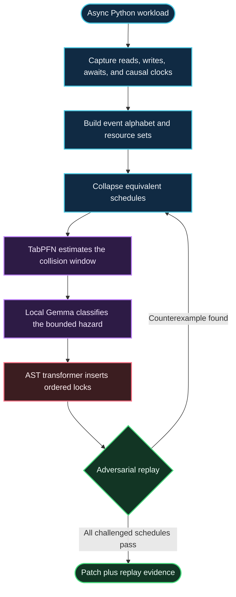

# To Yield, or Not to Yield: Why I Built a Concurrency Prover After School

I built **ChaosSloth** to answer a question that flaky async tests usually leave hanging: what exact ordering made this fail, and can I make it happen again on purpose?

ChaosSloth is a deterministic asynchronous concurrency verification engine for Python. It analyzes event-loop schedules, identifies conflicting accesses across `await` points, and synthesizes narrowly scoped synchronization so a failure can be replayed and fixed without turning the whole program into one giant lock. I work on it after school; the goal is straightforward: give a race a schedule, a location, and a patch someone can review.

> A green rerun is not an explanation. It is one schedule that did not lose the race.

The project’s reported live benchmark completed in **6.98 seconds**: a workload that failed **76.0%** of the time under natural event-loop jitter had **0 failures across 25 adversarial cycles** after patching. See [The 6.98-second proof](#the-698-second-proof).

## The green-rerun delusion

Python `asyncio` is cooperative: a coroutine runs until it yields, often at `await`. That does not make shared state magically safe. Two coroutines can both read a value, yield, then both write a result computed from the old value. No OS threads are required. The ingredients are shared mutable state and a yield between the read and write.

The familiar workaround is `await asyncio.sleep(0.1)`. It can change which schedule happens, which is not the same as making the shared-state update safe. Then CI fails again, the standup becomes a weather report about “flakiness,” and somebody clicks **Re-run failed jobs** until the badge turns green. A green badge says that run passed. It says nothing about the ordering that failed five minutes ago.

ChaosSloth treats schedules as evidence. It records the accesses, reduces equivalent schedules, locates a conflicting interval, and checks a deterministic replay after applying a patch.

## The 6.98-second proof

The following is the reported eight-stage live run, condensed to a terminal trace:

```text
$ chaossloth examples/counter.py
[1/8] Capture event-loop telemetry ................. 0.41s
[2/8] Build event alphabet and resource sets ....... 0.62s
[3/8] Collapse independent schedule permutations ... 0.38s
[4/8] Infer collision coordinate .................. 1.08s
[5/8] Diagnose semantic hazard locally ............ 1.76s
[6/8] Synthesize ordered AST lock enclosure ........ 0.94s
[7/8] Replay adversarial schedules ................. 1.31s
[8/8] Verify 25 cycles: 0 failures ................. 0.48s
----------------------------------------------------------
Completed in 6.98s | before: 76.0% failing | after: 0.0%
Replay: 10/10 reproductions on demand
Collision coordinate: 218.5 µs | posterior confidence: 88.35%
```

These are the project’s reported benchmark figures. Reproduce them against the benchmark workload and environment used for the run; timing and failure rates are workload-dependent.

## Architecture and pipeline



```mermaid
sequenceDiagram
    autonumber
    participant A as Coroutine A
    participant S as Shared counter
    participant B as Coroutine B
    A->>S: read 0
    Note over A,B: A yields at await; no OS thread is needed
    B->>S: read 0
    B-->>B: await completes
    B->>S: write 1
    A-->>A: await completes
    A->>S: write 1
    Note over A,S: Two increments completed; stored value is still 1
```

### 1. Trace reduction

ChaosSloth represents observable operations as an event alphabet `Σ`. Let `Res(a)` be the resources accessed by event `a`, and let `Write(a)` mean that `a` mutates a resource. Define the dependency relation:

$$
D = \{(a,b) \mid \operatorname{Res}(a) \cap \operatorname{Res}(b) \neq \varnothing \land (\operatorname{Write}(a) \lor \operatorname{Write}(b))\}
$$

$$
I = (\Sigma \times \Sigma) \setminus D
$$

`I` is the independence relation: event pairs that touch disjoint resources, or are read-only with respect to their shared resources. Two traces are equivalent when one can be obtained from the other by swapping adjacent independent events:

$$
\sigma_1 \equiv_I \sigma_2
$$

The explored state space is organized into quotient classes:

$$
\Sigma^{*} / {\equiv_I}
$$

rather than redundantly enumerating every permutation. In a worst-case workload with `N` mutually reorderable events, naïve permutation enumeration has factorial growth (`N!`); trace equivalence removes permutations that cannot change the result.

Lamport vector clocks provide the causal relation:

$$
e_1 \prec e_2 \quad\Longleftrightarrow\quad V(e_1) \leq V(e_2) \text{ componentwise and } V(e_1) \neq V(e_2)
$$

The reducer preserves causal order while identifying conflicting event pairs. This narrows the search to the schedule variations that can expose a collision.

### 2. Bayesian temporal inference

The pipeline feeds scheduling telemetry to a tabular Bayesian parameter-inversion stage. For observation `Δt*` and data `D`, the predictive probability is:

$$
p(y^{*}=1 \mid \Delta t^{*}, D) = \int p(y^{*}=1 \mid \Delta t^{*}, \theta)\,p(\theta \mid D)\,d\theta
$$

For the reported benchmark, the inferred critical timing coordinate was **218.5 µs**, with **88.35% posterior confidence**. ChaosSloth uses the inferred region to construct a deterministic schedule replay; the reported replay reproduced the failure **10 out of 10 times**. These are measured run results, not universal constants of the model or of Python.

### 3. Local semantic diagnosis

The diagnosis stage runs Google Gemma 2B locally through Ollama on an Apple M4, using Metal acceleration. The reported throughput is **52.9 tokens/second** on the benchmark machine. Its job is deliberately constrained to semantic hazard diagnosis: classify the bounded evidence and identify the relevant resource relationships. It does **not** generate unconstrained raw source code. The AST transformer makes the edit from structured hazard information, keeping code generation deterministic and reviewable.

### 4. Dijkstra-ordered disjoint hazard enclosure

The compiler uses Python’s `ast.NodeTransformer` to discover and protect state accesses. Discovery includes attribute reads, subscript stores, and mutating methods such as `.append()` and `.update()`.

If a critical interval touches multiple resources, each generated lock receives a stable rank. Locks are acquired in strict total order:

$$
\operatorname{rank}(\ell_A) < \operatorname{rank}(\ell_B) \quad\Longleftrightarrow\quad A \prec_{\mathrm{lex}} B
$$

This is the standard lock-ordering argument (often associated with Havender’s deadlock-prevention conditions): if every acquisition follows one strict global order, a wait-for cycle would require ranks to increase around a cycle and return to the starting rank, which is impossible. The guarantee depends on all relevant acquisitions following the same order; unrelated locks or external code that violates the order are outside that argument.

The allowed acquisition edges form a directed acyclic graph:


For a read `s_r`, write `s_w`, and an intervening yield, the patch encloses the smallest statement interval that protects the read-modify-write invariant:

$$
[s_r, s_w]
$$

This aims to minimize serialized work in the spirit of Amdahl’s law: asynchronous work outside that interval remains eligible to interleave. “Minimal” here means minimal with respect to the identified access interval and program structure, not a claim that globally optimal synchronization is computable for arbitrary Python programs.

Generated guards initialize locks lazily:

```python
if not hasattr(self, "_lock_counters"):
    self._lock_counters = asyncio.Lock()
```

The transformer’s output remains ordinary Python and can be reviewed as a diff.

### Representative multi-resource AST diff

This illustrates the expected shape of a two-resource patch; it is a schematic example, not a source diff from a repository checkout.

```diff
 async def settle(self, session_id, delta):
-    balance = self.counters[session_id]
-    await self.sessions[session_id].validate()
-    self.counters[session_id] = balance + delta
-    self.sessions[session_id].events.append(("settled", delta))
+    if not hasattr(self, "_lock_counters"):
+        self._lock_counters = asyncio.Lock()
+    if not hasattr(self, "_lock_sessions"):
+        self._lock_sessions = asyncio.Lock()
+    async with self._lock_counters, self._lock_sessions:
+        balance = self.counters[session_id]
+        await self.sessions[session_id].validate()
+        self.counters[session_id] = balance + delta
+        self.sessions[session_id].events.append(("settled", delta))
```

The emitted acquisition order must be stable and consistent at every call site. The example shows the requested multi-variable shape; actual indentation and lock placement depend on the analyzed method and its control flow.

## Quickstart and CLI

```bash
git clone https://github.com/smtherer/ChaosSloth.git
cd ChaosSloth
python -m venv .venv
source .venv/bin/activate
pip install -e .
chaossloth path/to/your_async_program.py
```

The CLI entry point and exact options should be confirmed against the checked-out package metadata. The command above shows the project’s intended quickstart invocation.

## Hacktoberfest 2026 prize categories

The categories below map the project’s stated award tracks to their technical focus. A category listing does not by itself establish an official event affiliation, sponsor commitment, or prize guarantee.

| Category | Project contribution / judging focus |
|---|---|
| **Slow & Steady — Top Prize** | End-to-end deterministic concurrency verification and the live benchmark |
| **Prior Labs — TabPFN** | Bayesian inversion of event-loop scheduling telemetry |
| **Google — Gemma** | Local, bounded semantic hazard diagnosis with Gemma 2B |
| **Render** | Deployable live benchmark dashboard and result presentation |
| **Sentry** | Clear failure evidence, deterministic reproduction, and actionable diagnostics |

## Links

- **Live dashboard:** [chaossloth-dashboard.onrender.com](https://chaossloth-dashboard.onrender.com)
- **GitHub:** [github.com/smtherer/ChaosSloth](https://github.com/smtherer/ChaosSloth)

## The point

An optimistic CI rerun tells you that one schedule got lucky. A replayable counterexample tells you which events collided, and a verified patch tells you the collision stopped happening under the schedules you tried. Formal evidence beats clicking **Re-run failed jobs** and hoping the computer has learned manners.
