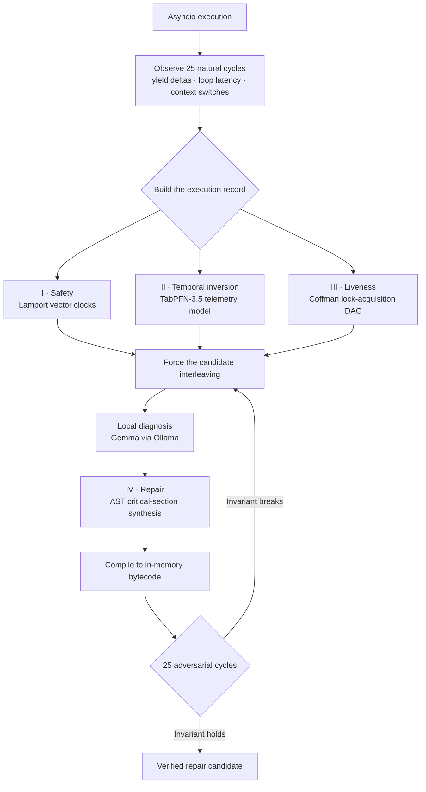

# ChaosSloth 🦥

> A concurrent system has no single present tense. It has events, and the order they can prove.
>
> **The Autonomous Bayesian Concurrency Interleaver & Deterministic Race-Condition Exorcist**

[](#hacktoberfest-2026-partner-prize-submissions)
[](#installation--quickstart)
[](#why-cloud-ai-fails-here)
[](#license)

ChaosSloth is an autonomous concurrency investigation engine for Python `asyncio`. It finds the schedule that breaks an invariant, reconstructs that schedule on demand, and synthesizes a focused synchronization repair. Causal analysis, Bayesian temporal inversion, lock-graph auditing, local model reasoning, and sandbox verification turn an intermittent failure into an executable case file: evidence gathered; hypothesis stated; schedule replayed; repair put on trial.

For Hacktoberfest 2026 / DEV Challenge, the theme is **“Slow and Steady”**—International Sloth Day made into a systems thesis. Frantic motion is the amateur’s substitute for understanding. Mastery is mathematical stillness: let the machine count, compare, and replay until chance has nowhere left to hide.

## 1. The Heisenbug Tax

A race condition is not bad luck. It is a tax levied in microseconds and collected in hours. One failure; then green. One red build among a hundred. The invoice arrives as eroded confidence, a release held hostage, and a team learning to distrust the machine it built.

The Heisenbug is software’s quantum parable: an execution state that refuses to survive observation. A print statement inserts work. A debugger changes pauses. Instrumentation perturbs the hot path. The event loop takes another step; the failure leaves no body behind. The observer effect arrives with a stack trace. To look is to alter the schedule that made the defect visible.

Then the ritual begins. Rerun the workflow. Wait. Rerun it again. Five hundred builds later: heat without light, activity without knowledge. `@pytest.mark.flaky(reruns=5)` is architectural bribery—pay the test to stop complaining, sweep live ammunition beneath the cluster rug. A green check purchased with retries is not confidence. It is silence, itemized at CI rates.

ChaosSloth treats flakiness as a schedule to reconstruct, not a temperament to tolerate. It samples natural execution; establishes causal order; infers the timing boundary; forces the collision; subjects the repair to adversarial cycles. It does not ask the failure to become convenient. It makes the failure repeat until it can be named.


```mermaid
sequenceDiagram
    autonumber
    participant A as Task A
    participant B as Task B
    participant X as Shared state x
    A->>X: read x = 0
    A-->>A: await — execution yields
    B->>X: read x = 0
    B->>X: write x = 1
    A->>X: write x = 1 from stale value
    Note over A,X: Two increments; one update disappears
```

The failure is not that either task ran incorrectly. Each followed its local script. The defect is in the missing relation between them: the system allowed both read-modify-write histories to overlap without an atomic boundary.

## 2. The Sloth’s Manifesto

At 2 a.m., the engineer is lit by the CI dashboard, launching build 500 and watching a progress bar as though it had received a prophecy. The sloth refuses the panic. It sits with the event history. Bayesian priors narrow the search; vector clocks establish which events could have caused which others. Silence is not inactivity. It is computation without theatre.

Urgency is not rigor. Repetition is not knowledge. An experiment earns its cost only by reducing uncertainty. The Sloth automates the tedious search, preserves the evidence, and returns human attention to judgments machines cannot own: whether the invariant expresses the contract, whether the repair preserves it, whether the change deserves to ship.

“Slow and steady” means deliberate computation at machine speed. ChaosSloth observes, reasons, replays, and verifies while the developer closes the laptop. The purpose is not less thought, but thought no longer squandered on ritual. Engineered laziness refuses to repeat by hand what a system can establish consistently; it also demands that automation return evidence, not merely a green light.

## 3. The Four Pillars of Concurrency

Four pillars carry the argument from observation to repair. Telemetry supplies the facts. Causal analysis gives them order. Temporal inversion identifies where to look. Liveness analysis guards the lock structure. AST synthesis makes the smallest useful change. Then deterministic replay and sandboxed bytecode verification put that change on trial. Mathematics is not ornament laid over a log; it is the means by which an execution history becomes legible, and a repair becomes falsifiable.



### The observation window

ChaosSloth captures coroutine yield timings, event-loop latency deltas, and context switches over **25 natural cycles**. The loop leaves its own footprints: pauses, handoffs, and the small delays in which one task can enter another task’s unfinished sentence. That record is the baseline from which the candidate schedule is inferred.

### Pillar I — Safety: Lamport’s happens-before relation

For conflicting events $e_1$ and $e_2$ on the same memory location, a race exists when neither event causally precedes the other and at least one is a write. Let $W(e)$ mean “event $e$ writes this location”:

$$
\neg(e_1 \prec e_2)
\land \neg(e_2 \prec e_1)
\land \bigl(W(e_1) \lor W(e_2)\bigr)
\implies \text{data race}
$$

Lamport vector clocks encode the partial order of events across tasks. There is no universal “now” shared by concurrent operations—only events and the causal relation $e_1 \prec e_2$. A wall clock may place two events on a timeline; it cannot manufacture a causal edge between them. When conflicting events are incomparable, the order witnessed in one run makes no promise about the next. ChaosSloth uses that distinction to separate harmless concurrency from a race capable of breaking an invariant.

### Pillar II — State-space inversion: TabPFN-3.5

Prior Labs TabPFN-3.5 runs locally as an active analysis agent over tabular scheduling telemetry. It evaluates the observed state in context and isolates the critical non-linear delay coordinate where an invariant collapses: **240.1 µs**, at **69.64% posterior confidence**.

The inference is Bayesian in the literal sense: evidence revises the relative plausibility of candidate timing regions. For hypothesis $H$ and observed telemetry $D$, the governing relation is

$$
P(H\mid D)=rac{P(D\mid H)P(H)}{P(D)}.
$$

Here, $H$ is a candidate temporal boundary and $D$ is the measured scheduling record. The model turns a high-dimensional timing landscape into a coordinate that can be tested. That coordinate becomes a concrete schedule for deterministic interleaving. A fleeting accident acquires a timestamp and a replay path; chance is no longer asked to testify—the schedule is called back to the stand.

### Pillar III — Liveness: the Coffman lock DAG

ChaosSloth dynamically audits `asyncio.Lock` acquisition dependencies as a directed graph. Vertices represent the participants in the wait; edges record who is waiting on whom. A directed cycle closes the trap: every participant holds a resource needed by the next, and no one can move first. For the observed lock graph $G=(V,E)$, liveness requires acyclicity:

$$
G \text{ is a DAG} \iff
\text{there is no sequence } v_0,\ldots,v_k \text{ with } k \ge 1,
(v_i,v_{i+1}) \in E \text{ for every } 0 \le i < k,
\text{ and } v_k=v_0.
$$

The Coffman condition gives liveness a graph-theoretic test: a strictly acyclic lock-acquisition graph contains no circular wait in the observed dependency relation. ChaosSloth also searches for synchronous blocking primitives that can pin the event loop in place. A program can preserve every value and still fail by never reaching its next instruction. Safety without progress is a system that has stopped.

### Pillar IV — Amdahl-optimal critical-section slicing

A local Google Gemma model diagnoses the critical section; Python’s `ast.NodeTransformer` then synthesizes an atomic lock around the complete read-modify-write cycle. The boundary matters. Protect only the write and the stale read has already escaped; protect the entire coroutine and unrelated work queues behind a needless gate. For a shared session store, the generated patch protects the `get`, `append`, and `set` sequence:

```python
async with self._lock:
    current = self.sessions.get(user_id, [])
    current.append(token)
    self.sessions[user_id] = current
```


The shaded middle is the invariant’s boundary. The delay stays outside; the state transition stays indivisible. A lock is a gate, and every instruction placed behind it pays a serialization cost.

Non-blocking delays and yields remain outside the lock. Locking the entire coroutine would needlessly serialize unrelated work. Amdahl’s Law makes the cost plain: if $P$ is the parallelizable fraction of a workload and $N$ is the number of workers, the speedup is bounded by

$$
S(N)=\frac{1}{(1-P)+\frac{P}{N}}
$$

The art is not to lock everything. It is to draw the boundary exactly where the invariant demands it: broad enough to make the state transition indivisible, narrow enough to leave unrelated work in motion.

### Sandboxed verification

The modified AST is compiled into in-memory bytecode and run through 25 adversarial cycles. The measured race rate falls from **68.0% to 0.0% in 9.07 seconds**. The candidate schedule reproduces the race **10/10 times** before repair. The patched execution satisfies the checked happens-before invariants and the lock acquisition DAG remains acyclic.

## 4. Why Cloud AI Fails Here

A cloud LLM may be brilliant; it is still at the wrong end of a wire. ChaosSloth is locating a **240.1 µs** scheduling coordinate. The network round trip belongs to another temporal scale; the request path adds its own variance to the investigation. A distant service cannot be the silent witness to a microsecond crime. The timing boundary is in the process, the model call is elsewhere, and the experiment has already changed before the answer returns.

Then there is memory: the program’s memory, and the memory bus carrying its state. Source code and execution traces can hold credentials, customer records, and the map of a proprietary system. ChaosSloth keeps inference local and air-gapped; program context stays beside the process that produced it. No upload. No external inference dependency. No per-query meter running with every replay. Once installed, local inference has zero marginal cost.

Google Gemma 2B/9B runs through Ollama. On the **Apple M4**, Gemma 2B uses Metal at **52.91 tokens/sec**. It reads the dynamic AST context and diagnoses the unsynchronized read-modify-write collision; the compiler transformation turns that diagnosis into an atomic candidate, and the sandbox decides whether the candidate survives contact with adversarial schedules.

## 5. The Benchmark Run

```text
╭────────────────── CHAOSSLOTH :: ASYNC CONCURRENCY EXORCIST ──────────────────╮
│                                                                              │
│    ⚡ Leslie Lamport Vector Clocks (Safety Invariant: ¬(e1 ≺ e2))            │
│    ⚡ Prior Labs TabPFN-3.5 (In-Context Bayesian State-Space Inversion)      │
│    ⚡ Google Gemma 2B/9B (AST Synchronization & Atomic Lock Synthesis)       │
│    ⚡ Coffman Lock Acquisition DAG (Liveness & Deadlock Prevention)          │
│                                                                              │
╰─ Autonomous Bayesian Interleaver • Formal Verification • Air-Gapped Local AI─╯
▶ [1/8] SAMPLING BASELINE ASYNCHRONOUS TELEMETRY ... running
▶ [2/8] INVERTING TEMPORAL BOUNDARY VIA PRIOR LABS TABPFN-3.5 ... running
                     Prior Labs TabPFN-3.5 Telemetry Matrix                     
┏━━━━━━━━━━━━━━━━━━━━━━━━━━━┳━━━━━━━━━━━━━━━━━━━━━━┳━━━━━━━━━━━━━━━━━━━━━━━━━━━┓
┃ Parameter / State         ┃ Observed Measurement ┃ Engine Interpretation     ┃
┡━━━━━━━━━━━━━━━━━━━━━━━━━━━╇━━━━━━━━━━━━━━━━━━━━━━╇━━━━━━━━━━━━━━━━━━━━━━━━━━━┩
│ Baseline Sampling Cycles  │ 25 Iterations        │ Empirical async sampling  │
│ Observed Flakiness Ratio  │ 68.0%                │ Intermittent failure rate │
│ Critical Failure Coord    │ 240.1 µs delay       │ TabPFN inverted boundary  │
│ Bayesian Confidence Score │ 69.64%               │ Posterior certainty       │
│ Targeted Reproducibility  │ 100.0% (10/10)       │ Deterministic reproduction│
└───────────────────────────┴──────────────────────┴───────────────────────────┘
▶ [3/8] ENFORCING DETERMINISTIC COLLISION INTERLEAVING ... running
▶ [4/8] AUDITING ACTIVE LOCK ACQUISITION DAG (COFFMAN CHECK) ... running
  ✔ Liveness Verified: Directed lock graph is strictly acyclic. No deadlocks possible.
▶ [5/8] AUDITING EVENT-LOOP STARVATION & BLOCKING PRIMITIVES ... running
  ✔ Responsiveness Verified: Zero synchronous blocking primitives detected.
▶ [6/8] QUERYING LOCAL GOOGLE GEMMA VIA OLLAMA (DYNAMIC AST CONTEXT) ... running
  Gemma Local Diagnosis: Unsynchronized Read-Modify-Write state collision across await boundaries.
▶ [7/8] SYNTHESIZING AST & IN-MEMORY BYTECODE COMPILATION ... running
╭─────────────────────── Deterministic AST Atomic Patch ───────────────────────╮
│    1 --- a/SharedSessionStore.py                                             │
│    2 +++ b/SharedSessionStore.py                                             │
│    3 @@ -1,13 +1,15 @@                                                       │
│    4  class SharedSessionStore:                                              │
│    5 +                                                                       │
│    6      def __init__(self):                                                │
│    7          self.sessions: Dict[str, List[str]] = {}                       │
│    8 +        self._lock = asyncio.Lock()                                    │
│    9                                                                         │
│   10      async def update_session(self, user_id: str, token: str):          │
│   11          if random.random() < 0.45:                                     │
│   12              await asyncio.sleep(random.uniform(0.0002, 0.0008))        │
│   13          else:                                                          │
│   14              await asyncio.sleep(1e-05)                                 │
│   15 +        async with self._lock:                                         │
│   16 +            current = self.sessions.get(user_id, [])                   │
│   17 +            current.append(token)                                      │
│   18 +            self.sessions[user_id] = current                           │
╰──────────────────────────────────────────────────────────────────────────────╯
▶ [8/8] SANDBOXED VERIFICATION ACROSS 25 ADVERSARIAL CYCLES ... running
╭──────────────────────────────────────────────────────────────────────────────╮
│                                                                              │
│  ✔ VERIFICATION COMPLETE IN 9.07s                                            │
│    • Pre-Patch Race Rate : 68.0%                                             │
│    • Post-Patch Race Rate: 0.0%                                              │
│                                                                              │
│  All Lamport Happened-Before invariants satisfied. Coffman lock DAG acyclic. │
│  Sloth mode fulfilled. Safe to merge.                                        │
│                                                                              │
╰──────────────────────────────────────────────────────────────────────────────╯
```

## 6. Installation & Quickstart

Clone the repository and install ChaosSloth in editable mode:

```bash
git clone https://github.com/smtherer/ChaosSloth.git
cd ChaosSloth
python -m venv .venv
source .venv/bin/activate
python -m pip install -e .
```

Run the autonomous analyzer:

```bash
chaossloth
```

Analyze a specific class and method:

```bash
chaossloth path/to/file.py --cls SharedSessionStore --method update_session
```

Run the pytest integration:

```bash
pytest --chaossloth
```

For local AST diagnosis, install Ollama and make the supported Gemma model available. TabPFN-3.5 and Gemma inference run locally; configure Render and Sentry separately for the web dashboard and agent tracing.

## 7. Hacktoberfest 2026 Partner Prize Submissions

ChaosSloth is built for the **Slow and Steady** challenge and enters the partner tracks with one claim: concurrency deserves evidence at the scale where it breaks. Each integration has a distinct job in that argument.

| Prize Category | Value | Case for the Track |
|---|---:|---|
| 🏆 Slow & Steady — Top Prize | $250 | I enter this track because ChaosSloth replaces frantic reruns and manual fuzzing with patient Bayesian analysis, deterministic replay, and sandbox verification. The engineer can leave the dashboard; the evidence keeps working. |
| 🌟 Prior Labs — Best Use of TabPFN | $200 | My Prior Labs entry puts TabPFN-3.5 inside the runtime investigation: it reads system-level scheduling telemetry and identifies the 240.1 µs temporal boundary associated with invariant failure. |
| 🌟 Google Gemma — Best Use of Gemma | $200 | For Gemma, I run the 2B model locally through Ollama on Apple M4 Metal at 52.91 tokens/sec. It diagnoses AST critical sections while source and trace context remain air-gapped. |
| 🌟 Render — Best Use of Render | $200 | Render carries the live telemetry explorer and agent dashboard; `render.yaml` makes the deployment part of the project rather than a hand-maintained afterthought. |
| 🛡️ Sentry — Best Agent Tracing | $100 | I bring Sentry into the agent’s chain of reasoning: traces cover TabPFN inversion spans, Gemma reasoning latency, and sandbox verification cycles, exposing the cost of each step in the diagnosis. |
| 🌐 .tech Domains | $100 | The .tech entry has a public endpoint: the production dashboard is live at [chaossloth.tech](https://chaossloth.tech), where the project’s telemetry story leaves the terminal and meets its users. |

## 8. Deployment & License

The live telemetry explorer and agent dashboard run on Render, described in `render.yaml`; the production dashboard is live at [chaossloth.tech](https://chaossloth.tech). Sentry follows the work across TabPFN inversion spans, Gemma reasoning latency, and sandbox verification cycles. The observer, too, is observed: each stage leaves a trace of its own cost.

ChaosSloth is licensed under the [Apache License, Version 2.0](https://www.apache.org/licenses/LICENSE-2.0). See `LICENSE` for the full license text.
