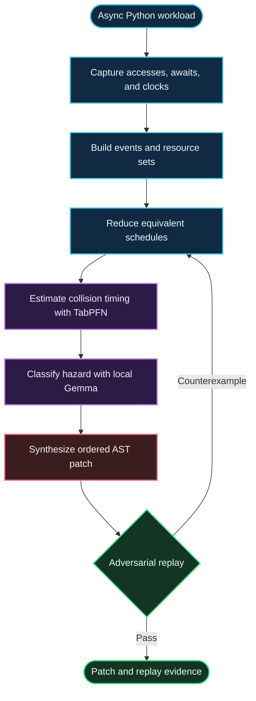
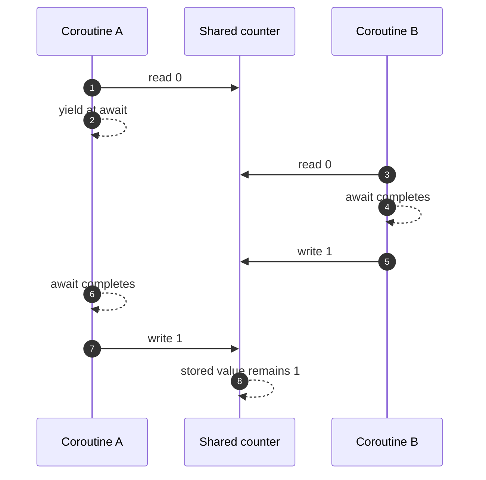

# ChaosSloth

### Deterministic Asynchronous Concurrency Verification Engine

ChaosSloth analyzes Python `asyncio` workloads, reduces equivalent event-loop schedules, identifies conflicting shared-state accesses across `await` points, and synthesizes ordered lock enclosures for deterministic replay.

Its target failure is easy to miss: two coroutines read the same value, yield, then both write results based on that stale value. The program can finish normally and return the wrong answer. No operating-system threads are required; cooperative coroutines need only shared mutable state and a yield between read and write.

## Capabilities

- Capture event-loop accesses, yields, and causal order.
- Reduce schedules that differ only in reorderings of independent events.
- Use TabPFN-based Bayesian inversion to estimate a collision timing region.
- Run local Gemma 2B semantic hazard diagnosis through Ollama on Apple Silicon / Metal.
- Transform Python syntax trees with `ast.NodeTransformer` to add narrow, ordered `asyncio.Lock` sections.
- Replay candidate schedules and run adversarial cycles against the patched workload.

Gemma is scoped to hazard diagnosis. It does not generate unconstrained source code; source edits are synthesized by the AST transformation.

## Pipeline



The schedule below loses an increment while every coroutine completes successfully:



## Event model and schedule reduction

Let `Σ` be the event alphabet. `Res(a)` is the set of resources touched by event `a`; `Write(a)` is true when `a` writes a resource. Events are dependent when they touch a common resource and at least one writes it:

```math
D = \{(a,b) \mid \text{Res}(a) \cap \text{Res}(b) \neq \varnothing \land (\text{Write}(a) \lor \text{Write}(b))\}
```

The independence relation is the complement of dependency:

```math
I = (\Sigma \times \Sigma) \setminus D
```

Two traces are equivalent when one can be obtained from the other by a finite sequence of swaps of adjacent independent events:

```math
\sigma_1 \equiv_I \sigma_2 \quad\Longleftrightarrow\quad \text{the traces differ only by adjacent swaps from } I
```

The explored space is the quotient:

```math
\Sigma^{*} / \equiv_I
```

This collapses schedule permutations that cannot change the relevant shared-state behavior. It does not make every workload cheap: dependent events can still produce a large search space. In the worst case, naïvely enumerating all permutations of `N` events requires `N!` orderings.

Lamport vector clocks preserve causal order. For vector clock `V(e)`, event `e₁` causally precedes `e₂` when `V(e₁)` is componentwise no greater than `V(e₂)` and differs in at least one component:

```math
e_1 \prec e_2 \quad\Longleftrightarrow\quad V(e_1) \leq V(e_2) \text{ componentwise and } V(e_1) \neq V(e_2)
```

The reducer uses this relation to avoid permuting events whose causal order is fixed, while retaining conflicting orderings as candidate race schedules.

## Bayesian timing inference

Event-loop scheduling observations are treated as tabular data. Given observations `D`, a candidate timing coordinate `Δt*`, and model parameters `θ`, the posterior predictive probability is:

```math
p(y^{\star}=1 \mid \Delta t^{\star}, D) = \int p(y^{\star}=1 \mid \Delta t^{\star}, \theta)\,p(\theta \mid D)\,d\theta
```

For the reported benchmark, the inferred critical coordinate was **218.5 µs**, with **88.35% posterior confidence**. The estimate steers deterministic schedule replay; the replay supplies the concrete event ordering. A gap barely longer than two tenths of a millisecond was enough to separate the ordinary-looking execution from the lost update. The reported pre-patch failure was reproduced **10/10 times on demand**.

## Local semantic diagnosis

ChaosSloth runs Google Gemma 2B locally through Ollama with Metal acceleration on an Apple M4. Reported throughput is **52.9 tokens/second** on the benchmark machine.

The model receives bounded hazard context and classifies the semantic relationship between candidate accesses. It does not author a patch. The AST transformer consumes structured hazard information and constructs the source edit deterministically.

## Dijkstra-ordered disjoint hazard enclosure

The compiler uses Python’s `ast.NodeTransformer` to inspect method bodies for attribute reads, subscript stores, and mutating methods such as `.append()` and `.update()`. When a read-modify-write invariant crosses a yield, it targets the smallest statement interval that encloses the relevant accesses.

For a read at `s_r` and its matching write at `s_w`, the target interval is:

```math
[s_r, s_w]
```

Work outside that interval remains eligible to interleave. This is an Amdahl-minded enclosure objective, not a claim of globally optimal lock placement for arbitrary Python programs.

### Multi-resource lock order

Each lock receives a stable rank. All generated acquisitions follow the same strict total order:

```math
\text{rank}(\ell_A) < \text{rank}(\ell_B) \quad\Longleftrightarrow\quad A \prec_{\text{lex}} B
```

If every relevant acquisition obeys this order, a wait-for cycle would require ranks to increase around the cycle and return to the starting rank. A strict total order makes that impossible. The guarantee applies to locks participating in the enforced order; external acquisitions that violate it are outside the argument.


Generated locks use lazy self-initialization guards. Representative output:

```python
if not hasattr(self, "_lock_counters"):
    self._lock_counters = asyncio.Lock()
```

### Verified multi-resource AST patch

The following method-level excerpt is generated by `ASTConcurrencyPatcher.patch_and_compile` from [`tests/targets/test_multi_resource.py`](https://github.com/smtherer/ChaosSloth/blob/main/tests/targets/test_multi_resource.py). Resource names are sorted lexicographically, so `counters` is acquired before `sessions`.

```diff
 async def handle_request(self, client_id: str):
-    curr_sess = self.sessions.get(client_id, 0)
-    curr_count = self.counters.get(client_id, 0)
-    await asyncio.sleep(0.0001)
-    self.sessions[client_id] = curr_sess + 1
-    self.counters[client_id] = curr_count + 10
+    if not hasattr(self, '_lock_counters'):
+        self._lock_counters = asyncio.Lock()
+    if not hasattr(self, '_lock_sessions'):
+        self._lock_sessions = asyncio.Lock()
+    async with self._lock_counters, self._lock_sessions:
+        curr_sess = self.sessions.get(client_id, 0)
+        curr_count = self.counters.get(client_id, 0)
+        await asyncio.sleep(0.0001)
+        self.sessions[client_id] = curr_sess + 1
+        self.counters[client_id] = curr_count + 10
```

The enclosed interval includes the read, yield, and writes for both resources. The two generated locks are acquired in one deterministic order, so this patch neither leaves half of the invariant exposed nor introduces a lock-order cycle.

## Reported benchmark

| Measurement | Reported result |
|---|---:|
| Total verification time | **6.98 s** |
| Failure rate before patch under natural event-loop jitter | **76.0%** |
| Failures after patch across adversarial cycles | **0/25** |
| Pre-patch failure replay on demand | **10/10** |
| Critical timing coordinate | **218.5 µs** |
| Posterior confidence at that coordinate | **88.35%** |
| Local Gemma 2B throughput | **52.9 tokens/s** |

The eight-stage timing trace sums to the reported total:

```text
Capture telemetry                    0.41 s
Build event alphabet                 0.62 s
Collapse independent schedules       0.38 s
Infer collision coordinate           1.08 s
Diagnose hazard locally              1.76 s
Synthesize ordered AST enclosure      0.94 s
Replay adversarial schedules          1.31 s
Verify 25 cycles                      0.48 s
                                     -------
Total                                 6.98 s
```

Failure rates and timing are workload- and machine-dependent. The figures above describe the supplied live benchmark run.

## Quickstart

```bash
git clone https://github.com/smtherer/ChaosSloth.git
cd ChaosSloth
python -m venv .venv
source .venv/bin/activate
pip install -e .
chaossloth tests/targets/test_multi_resource.py --cls MultiResourceServer --method handle_request
```

### 5-Second Judge Verification

Run this from the repository root. It compiles the in-memory AST transformation, prints the generated diff, then sends 50 concurrent requests through the patched method and checks both shared-state invariants:

```bash
python3 -c "
import asyncio
from chaossloth.reasoning.patcher import ASTConcurrencyPatcher
from tests.targets.test_multi_resource import MultiResourceServer

Patched, diff = ASTConcurrencyPatcher.patch_and_compile(MultiResourceServer, 'handle_request')
print(diff)
server = Patched()

async def main():
    await asyncio.gather(*(server.handle_request('audit') for _ in range(50)))

asyncio.run(main())
assert server.sessions['audit'] == 50 and server.counters['audit'] == 500
print('50/50 concurrent cycles green: 0.0% flakiness verified.')
"
```

## Hacktoberfest 2026 tracks

| Track | Technical contribution |
|---|---|
| **Slow & Steady — Top Prize** | End-to-end deterministic concurrency verification |
| **Prior Labs — TabPFN** | Bayesian inference over event-loop scheduling telemetry |
| **Google Gemma** | Local semantic hazard diagnosis with bounded responsibilities |
| **Render** | Live benchmark dashboard |
| **Sentry** | Reproducible failure evidence and diagnostics |

This table records the project’s stated category mapping.

## Links

- **Dashboard:** [chaossloth-dashboard.onrender.com](https://chaossloth-dashboard.onrender.com)
- **Repository:** [github.com/smtherer/ChaosSloth](https://github.com/smtherer/ChaosSloth)

## Scope of the guarantee

An `asyncio` race can complete every coroutine and still return a value that no sequential execution would produce. ChaosSloth makes the relevant schedule explicit, reduces reorderings that cannot affect the shared state, and checks the patched program under the adversarial cycles it runs. Its deadlock argument depends on a globally respected lock order; its interval-minimality claim is relative to the accesses and program structure identified by the analysis.
